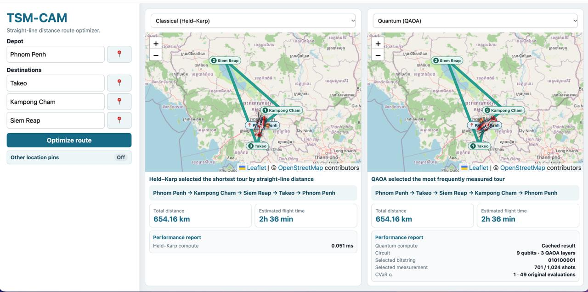

# TSM-CAM

TSM-CAM compares quantum and classical route optimization for Cambodia. Choose a depot and up to three destinations, then click **Optimize route** to see both round trips on separate maps. The app uses straight-line Haversine distances and shows each solver's route, distance, estimated flight time, and compute time.

**[Try the cloud demo](https://tsm-cam.onrender.com/)** · [Health check](https://tsm-cam.onrender.com/api/health)

## Solvers

| Engine | How it works |
| --- | --- |
| Quantum · QAOA | Uses Qiskit Aer to simulate a circuit with a permutation-swap mixer. It decodes the most frequently measured bitstring into a route. |
| Classical · Held–Karp | Uses dynamic programming to find the exact shortest tour on the same distance matrix. |

## Run locally

From the repository root:

```bash
python3 -m venv .venv
source .venv/bin/activate
python -m pip install -r requirements.txt
TSM_OFFLINE=1 python -m uvicorn app.main:app --reload
```

Open [localhost:8000](http://127.0.0.1:8000/). QAOA settings are in [config.py](app/quantum/config.py).


