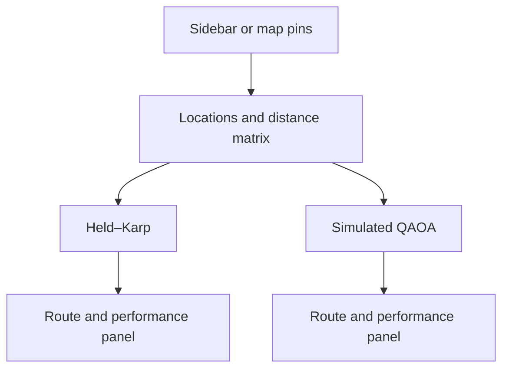

# TSM-CAM project structure

TSM-CAM compares two Traveling Salesperson Problem solvers for a Cambodian round trip. The browser sends one depot and up to three destinations. FastAPI resolves the stops once and gives both solvers the same Haversine distance matrix.

## Main files

| File or folder | Responsibility |
| --- | --- |
| [app/main.py](../app/main.py) | FastAPI endpoints, shared route preparation, solver dispatch and response assembly. |
| [app/schemas.py](../app/schemas.py) | Request, response, map-pin and quantum run models. |
| [app/classical/](../app/classical/) | Place lookup, Haversine distances, Held–Karp and route geometry. |
| [app/quantum/qaoa.py](../app/quantum/qaoa.py) | Fixed-depot encoding, permutation-swap mixer, simulation and bitstring decoding. |
| [app/quantum/config.py](../app/quantum/config.py) | QAOA depth, sampling and optimizer defaults. |
| [templates/index.html](../templates/index.html) and [static/style.css](../static/style.css) | Shared sidebar, two map panels and the responsive layout. |
| [static/scripts/](../static/scripts/) | Leaflet setup, place search, map picking, markers, route drawing, animation and result rendering. |
| [offline-data/](../offline-data/) and [static/data/](../static/data/) | Local place index, province coordinates, boundaries and map artwork. |
| [scripts/](../scripts/) | Map-data preparation and QAOA experiment scripts. |

## Browser behavior

**Optimize route** submits both algorithm choices. By default the left map uses Held–Karp and the right map uses QAOA. Each map shows its own route and performance report. The depot and selected stops are visible before optimization, and destination labels gain visit numbers once a route is ready.

The website uses Leaflet with online OpenStreetMap tiles. Setting `TSM_OFFLINE=1` switches place lookup to the local index. Each route has an independent helicopter animation at 3× speed. **Other location pins** starts off. When enabled, those pins hide during playback and return two seconds after that map's flight finishes.

## API

| Endpoint | Purpose |
| --- | --- |
| `POST /api/routes/compare` | Main browser endpoint. Returns the left and right outcomes, shared timings and the distance gap when both solvers return routes. |
| `POST /api/routes/optimize` | Runs one solver selected by `solver_mode`. |
| `GET /api/places` and `GET /api/geocode` | Search for names and resolve coordinates. |
| `GET /api/reverse` | Resolve a coordinate picked from the map. |
| `GET /api/health` and `GET /health` | Return `{"status":"ok"}`. |
| `GET /docs` | Interactive FastAPI reference. |

Comparison results are independent. If one solver fails, its panel receives an error and the other panel can still show its route.

[Local setup and cloud demo](../README.md) · [Classical solver](CLASSICAL_PART.md) · [Quantum solver](QUANTUM_PART.md)
